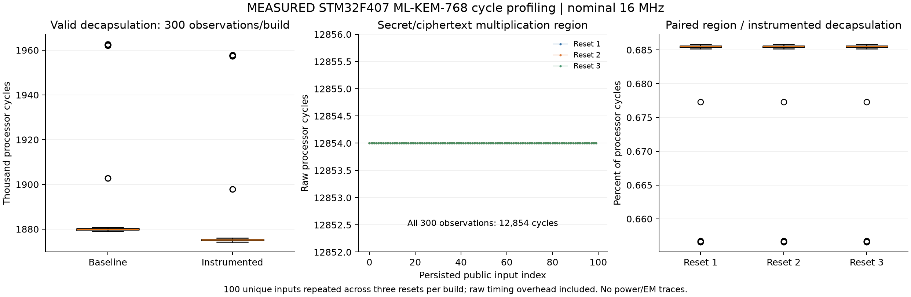

# STM32F407 ML-KEM-768 operation-level cycle profiling — 2026-11-06

**MEASURED DEVICE CYCLES; correctness checks and original-firmware restoration PASS.**

This adds an on-device measurement of the secret/ciphertext polynomial-vector multiplication/accumulation
inside `mlk_indcpa_dec`. Public ciphertext NTT/cache preparation and the following inverse NTT are outside
the region. The exact compiled call is bracketed by DWT reads and compiler/DSB/ISB barriers.



| Measurement | Median | IQR | Minimum–maximum |
|---|---:|---:|---:|
| Baseline valid decapsulation (cycles) | 1,880,012 | 506 | 1,878,996–1,962,685 |
| Instrumented valid decapsulation (cycles) | 1,875,189 | 506 | 1,874,173–1,957,814 |
| Multiplication region, raw (cycles) | 12,854 | 0 | 12,854–12,854 |
| Region duration at nominal 16 MHz (microseconds) | 803.375 | 0 | 803.375–803.375 |
| Paired region / instrumented decapsulation (%) | 0.685478 | 0.000185 | 0.656549–0.685849 |
| Instrumented empty bracket (cycles) | 8 | 0 | 8–8 |
| Matched instrumented − baseline decapsulation (cycles) | -4,823 | 0 | -4,871–-4,823 |

There are **100 unique public deterministic inputs, repeated across three resets per build**:
300 valid-decapsulation observations per build and 300 instrumented-region observations.
All samples, including first-use observations, are retained. Empty-bracket calibration has 64 readings
per reset (192 per build). The corpus varies both test keys and encapsulation coins; it is not a fixed-key CPA dataset.

Each instrumented run observed exactly one target-region call during each valid decapsulation and three
per complete test case (the additional two belong to rejection checks): **300 hooks per run**.
The valid call is saved immediately, before rejection tests. Host/device shared secrets and rejection
results agree for all inputs; malformed public/secret-key return checks pass.

Fresh host checks passed 100 corpus cases and all **435 pinned ACVP cases for each build**.
The independent SHAKE256 check covers each corpus rejection result. ARM ELF/binary bounds and bytes
were checked before programming, including a conservative 512 KiB bound within the existing VG configuration.

Both builds use portable C, ARM GCC 14.3.1, `-O2`, Cortex-M4 Thumb, soft float, no LTO.
Recorded `RCC_CFGR=0`, `FLASH_ACR=0`, DWT enabled and PRIMASK=1 match nominal HSI16 / AHB 1,
zero flash wait states, caches/prefetch off and interrupts disabled. No external frequency measurement was taken.

| Build | Flash image bytes | Static main SRAM bytes | Whole-harness stack high-water bytes |
|---|---:|---:|---:|
| baseline | 29,704 | 7,600 | 18,156 |
| instrumented | 29,800 | 7,600 | 18,156 |

Stack watermark is an estimate for the whole harness, not an operation-specific bound.

**Recovery:** a fresh full 1,048,576-byte preflash readback matched the preserved historical backup.
After collection, the original firmware was reprogrammed, read back in full, hash-verified and restarted.
The option word was unchanged. Private backups and programmer logs remain ignored; no backup was published.

**Interpretation limits:**

- No power/EM traces, GPIO trigger, CPA, key recovery or masking evaluation.
- Raw counts include timing-bracket/call/setup overhead; no automatic subtraction.
- Empty-bracket calibration is indicative, not an exact correction for the compiled call site.
- Whole instrumented decapsulation includes profiling and hook bookkeeping.
- Nominal HSI16 clock; frequency not externally measured.
- Three reset repetitions of the same 100 public test inputs on one board in one session.
- Baseline runs precede instrumented runs; comparison can include time/order and code-layout effects.
- SWD remains attached; first RAM read after 58 s, not during most computation.
- No timing-security conclusion follows from the observed variation.
- Existing VG configuration used as requested; this experiment does not establish physical chip identity.

The bracket includes the start-value RAM store, call argument setup/call/return and final barriers.
The empty-bracket sequence differs from the real call site, so it is not subtracted to claim exact intrinsic
function cycles. The matched build delta is descriptive and may include code-layout and run-order effects.

The instrumented image measured 4,823 fewer decapsulation cycles in the median matched pair.
This is not a negative instrumentation-overhead estimate or an established speed optimization;
the mechanism behind that build difference was not isolated in this experiment.

Evidence: [summary](summary.json), [all 600 records](cycles.csv),
[build checks](../build-summary.json), [acquisition](../acquisition.json),
[restoration](../restoration.json), [instrumented disassembly](instrumented-timing-disassembly.txt).

Reproduce software preparation from the repository root with fresh output directories:

```powershell
python validation/scripts/prepare_basemul_profile.py --out validation/build/new-basemul
python validation/scripts/test_basemul_profile.py
```

Hardware collection requires the explicitly authorized board/programmer setup and a matching private original backup.
Use fresh private/evidence paths; do not rerun blindly on a different board:

```powershell
python validation/scripts/run_basemul_profile.py --build validation/build/new-basemul --private validation/backups/new-basemul --out validation/evidence/new-basemul --execute
python validation/scripts/analyze_basemul_profile.py --build validation/build/new-basemul --evidence validation/evidence/new-basemul --out validation/evidence/new-basemul/analysis
```
